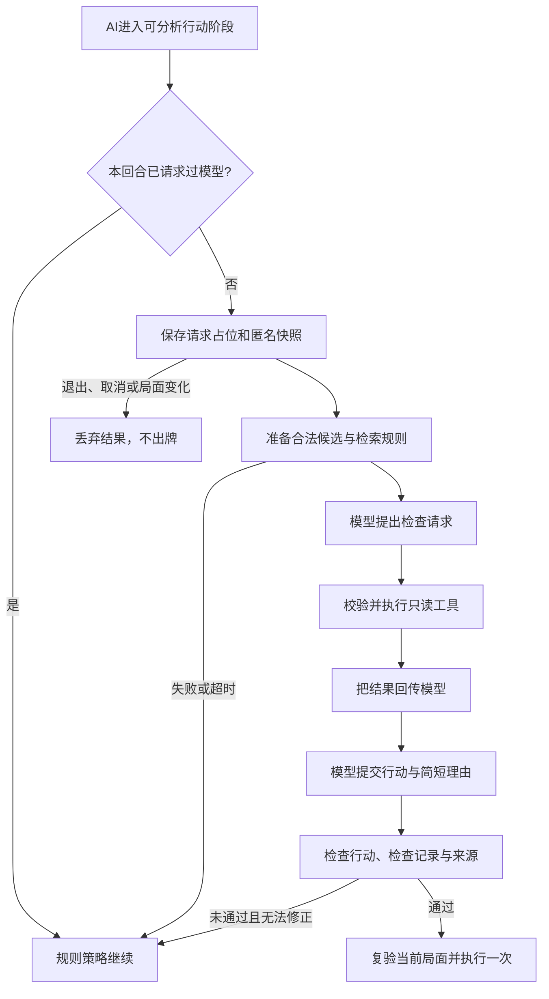

# 云端对手与玩法改进

日期：2026-10-27。本文记录已经落地的软件能力与复现方式，不是实验6报告。

## 1. 玩家入口与当前范围

推荐使用`npm run dev:all`同时启动前端与AI服务；按Ctrl+C同时停止本次启动的两个进程。端口被占用时会报错，不会结束其他已在运行的服务。

分别运行`npm run coach`与`npm run dev`，在本机配置可用的`DASHSCOPE_API_KEY`；默认模型为`qwen3.8-flash`。创建房间后，在大厅“机器人决策”中选择“云端智能体”，添加机器人并开始对局。默认“快速策略”继续采用本地规则AI，不依赖网络。

云端模式对每个机器人、每个系统回合编号最多请求一次。只有进入行动阶段、没有待领取奖励且至少有两个受支持候选时才分析；投骰、奖励选择、阶段结束以及本回合剩余操作仍由规则策略处理。选择云端模式即允许机器人自动执行通过校验的行动，不需要玩家逐次确认；玩家自己的“战术助手”仍保留人工确认。

第一版云端候选覆盖移动、罗素制动、冲刺、瞬步和瞬移四类移动行动，不包含全部道具。模型不能直接改棋盘、发牌、重掷骰子或操作存档。其他道具继续由已有规则AI使用。云端输出不保证最优路线，也没有替代完整的多人联机服务。

云端当前按手牌顺序规划第一张移动牌；玩家可以独立预览和使用库存中的其他移动牌。多张移动牌与其他道具的联合规划仍需进一步扩展。

## 2. 模型与工具如何完成一次行动

实现入口是[opponent.ts](../server/agent/opponent.ts)，对局控制器是[opponentController.ts](../src/agent/opponentController.ts)。HTTP接口为`POST /api/agent/opponent`，只接收当前AI席位的匿名`snapshot`和`playerId`；客户端不能传入任意工具名、修改预算或更换执行函数。

1. 程序解析局面，检查活动玩家、阶段、坐标、手牌与数据规模，隐藏其他玩家手牌、真实姓名和历史文字。
2. 使用真实只读工具准备最多6个合法候选及相关规则来源，组成`prepared_actions`与`prepared_sources`。候选排序依据本步完赛和静态距离，不代表模型已作决定。
3. 模型提出JSON工具请求，例如`inspect_action`及其`actionId`；程序验证工具名称与参数后，在隔离副本上执行。
4. 将模型调用请求和对应`tool_result`加入后续上下文。模型读取结果后继续查询或提交`final`，不能跳过显式检查直接完成。
5. 程序重新确认行动确实在已列出的候选中、曾被检查、引用来自实际规则检索且包含当前动作规则。通过后返回`ready`；这仍只是行动决定。
6. 浏览器控制器比较请求时的局面指纹、活动玩家和阶段，再通过规则入口执行一次。过期或迟到响应不能出牌。

模型可以按需调用`observe_board`、`list_actions`、`inspect_action`与`lookup_rules`，均为只读工具。它决定检查和选择哪个候选；候选生成、参数约束、权限、执行和停止条件由程序控制。默认没有系统命令、任意文件读写或动态代码执行工具。



## 3. 时限、失败与对局连续性

| 控制项 | 实际限制 |
| --- | --- |
| 模型步数 | 最多4步，一次模型请求计一步 |
| 单次模型等待 | 最长3.5秒，并受剩余总预算限制 |
| 单次工具等待 | 最长0.5秒 |
| 后端总预算 | 5秒，包含上下文准备与模型、工具调用 |
| 纠错 | 最多1次，同时受步数和总预算约束 |
| 客户端等待 | 最长6秒，为后端预算保留网络传输缓冲 |
| 重复请求 | 每个AI回合最多一次，无自动模型网络重试 |

模型未配置、额度不可用、连接失败、超时、非法JSON、伪造行动或错误来源都不能阻断整局。云端未通过检查时，控制器按“本步完赛优先、避免死亡地形、缩短静态距离、固定行动编号排序”选择合法降级行动；本回合后续继续规则AI。这个单步降级排序可复现，整局仍含投骰和奖励随机性，不能称为完全确定性对局。

取消或退出会停止等待；局面变化会使旧结果失效，这些情况不会执行旧的云端决定或降级动作。实际使用`AbortSignal`取消本地模型连接，但不能保证远端已经停止生成或计费。同步JavaScript计算不能被计时器强制抢占，因此还限制输入规模并在计算返回后复验耗时。动画倍速独立于模型时间预算。

## 4. 决策复盘与恢复

[OpponentInsight.vue](../src/components/OpponentInsight.vue)在对局和结算中展示思考状态、行动理由、规则编号及有限统计。`GameState.aiTelemetry`保存：

| 字段 | 含义 |
| --- | --- |
| `requests` | 已占用本回合调用名额的云端尝试次数 |
| `modelSuccess` | 云端决定通过当前局面复验并实际执行的次数 |
| `fallbacks` | 云端失败后由本地策略接管的次数 |
| `lastAttempt` | 最近尝试的回合编号与AI席位，防止同回合重复调用 |
| `recent` | 最近20条已完成的云端执行或降级摘要，新的在前 |

请求可能被取消、退出或刷新中断，所以`requests`不必等于`modelSuccess + fallbacks`，也不能用前两者的差直接表示降级次数。最近20条记录不覆盖所有请求，更不等于所有机器人动作。摘要只保留行动、简短理由、来源编号、耗时和降级原因，不保存完整上下文、原始模型输出或密钥。

模式与请求占位随本地自动存档恢复。若刷新发生在请求中途，同一回合恢复后直接由规则AI继续，不再次请求模型。旧存档没有`aiMode`时按`rules`处理；损坏或过长的模式、计数和摘要会被拒绝。恢复只重建本地对局，不恢复旧请求或执行迟到结果。

## 5. 玩法与操作修订

| 改进 | 玩家可见行为与实现依据 |
| --- | --- |
| 移动落点预览 | 选择移动牌后，四个方向显示本步结算位置、危险、奖励或终点提示；被阻挡方向不可选。预览复用规则引擎，不预测随机奖励具体内容 |
| 多移动牌选择 | 预览和执行都携带所选牌的`uid`，不会选了后一张却消耗前一张 |
| 传送带与制动 | 高亮路径复用实际滑行过程，包含传送带免费推进；罗素制动使用已支付移动次数，避免把免费格误算成额外移动 |
| 非法操作反馈 | 越界、错误目标和不可用方向保留手牌并给出提示；Esc可取消当前选择 |
| 道具边界 | 增强持牌、类型、阶段、方向和目标范围检查；造墙等相邻放置只使用空白地块，避免覆盖终点等特殊地形 |
| 结束锁定 | 连锁击退或回合开始的爆炸触发终点后，不再继续后续结算、发牌或改写胜者 |
| 规则对手选择 | 方向工具的比较使用一致评分，牵引检查真实模拟后的目标位置，减少无效果操作 |
| 教学首轮 | 规则教学机器人优先示范移动与交出回合，避免随机瞬移立即结束首轮；结算后不再等待不存在的真人回合 |

主要代码位于[engine.ts](../src/game/engine.ts)、[ai.ts](../src/game/ai.ts)、[MovementChoices.vue](../src/components/MovementChoices.vue)与[GameScreen.vue](../src/components/GameScreen.vue)。这些修订保持现有固定2.5D视角、拖动平移、滚轮缩放、拖牌与键盘操作、慢速演出和自动存档。

## 6. 验证与固定局面评估

运行`npm test`检查工具循环、参数与权限、停止边界、模型失败降级、取消与迟到响应、单次执行、复盘上限和存档兼容。`npm run build`执行前后端类型检查与生产构建。异常测试通过注入模型或工具受控触发，不冒充真实云端成功。

固定局面位于[opponent-positions.ts](../eval/opponent-positions.ts)，包括`safe`、`pit`、`poison`、`sprint`、`finish`五类。默认只跑固定排序的规则基线，不花费云端额度；显式加`--cloud`才调用配置的真实模型：

```powershell
npm run eval:opponents
npm run eval:opponents -- --case=pit
npm run eval:opponents -- --cloud --case=finish --save
npm run eval:opponents -- --cloud --case=safe --save
```

`--save`把合成局面、实际工具轨迹、规则基线与最终执行检查追加到`docs/opponent-runs/evaluation.json`，不会读取或覆盖玩家存档。每个组都在独立局面副本上检查、执行，并隔离随机流与编号。判据包括合法、避免死亡地形，以及该样例是否应在本步获胜；冲刺原地增加移动点不会仅因没有改变坐标而被判成劣解。

已保存的[真实云端记录](opponent-runs/evaluation.json)包含以下两次单样例运行，模型均为`qwen3.8-flash`：

| 样例 | 实际决定 | 模型步数 | 后端耗时 | Token总量 | 程序检查 |
| --- | --- | --- | --- | --- | --- |
| `finish` | 瞬移到终点`(6,0)` | 2 | 2513毫秒 | 2963 | 行动合法，实际副本执行后本步获胜 |
| `safe` | 向右移动 | 2 | 2226毫秒 | 1768 | 行动合法，未触发死亡地形，符合该样例预期 |

两次云端决定均被接受，对应规则基线也通过了样例判据。这是两次固定合成局面的单步检查，不能推出所有局面都在该时延内成功，也不能证明云端胜率、整局完赛率或策略质量优于规则AI。当前没有用这些样例计算整局排名或最优性分数。

人工复现可分别检查：正常云端回合的思考与出牌、关闭AI服务后的本地接管、思考期间退出并恢复、刷新同一回合不重复请求、结算页展开复盘，以及多张移动牌和传送带的预览与实际落点是否一致。故障测试后重新启动`npm run coach`即可恢复AI入口。

## 7. 课程能力对应与当前局限

| 能力 | 已接入个人软件的位置 |
| --- | --- |
| LLM | 规则教练、玩家战术助手与可选云端对手调用服务端模型适配层 |
| Context与RAG | 从当前规则库取得相关来源；局面与候选由引擎读取，模型上下文保存调用和工具结果 |
| 工具调用 | 4个只读工具的允许列表、字段约束、范围检查、真实执行及结果回传 |
| 单Agent | 模型根据目标与工具结果决定继续查询还是提交行动，程序独立验收 |
| 运行时Harness | 组织上下文、分发工具、执行预算、有限纠错、取消、日志与最终检查 |
| Eval Harness | 固定局面、规则基线与云端调用、隔离执行及统一判据，另有受控故障测试 |

以上能力已经参与软件运行，不以“使用AI写代码”替代产品内Agent。当前仍是本地实践对局，客户端维护游戏状态；后端验证匿名快照并不等于多人房间的权威状态验证。真实联机、防作弊、账号和跨设备恢复尚未实现。后续应扩大固定局面与整局评估，补齐更多道具决策，并在接入联网前建立服务端权威状态和命令版本校验。
