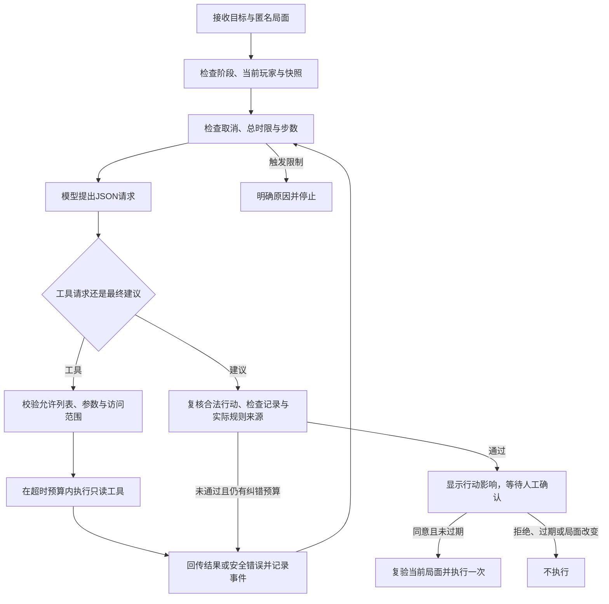

# 战术助手与运行时 Harness

本文说明《当骰一棒》当前已经实现的战术助手、工具接口和运行控制，供继续开发与复现使用。

## 1. 当前能力与入口

对局中的“战术助手”接受一个不超过120字的目标，例如“尽快接近终点”或“优先避开危险”。在真人玩家投骰完成、领取奖励后的行动阶段，助手查询当前局面的可选行动、推演行动结果并检索相关规则，形成一步建议。界面展示行动、消耗、落点、风险提示与规则来源；玩家点击“确认执行”后，本地练习由本地引擎执行，联机由房间服务复验版本与身份后执行。

第一版覆盖以下四类行动：

| 行动 | 范围 |
| --- | --- |
| 移动 | 使用当前第一张移动牌，选择方向；罗素可选择提前制动 |
| 冲刺 | 已有移动牌时，消耗冲刺牌并增加2点移动 |
| 瞬步 | 选择引擎允许的附近落点 |
| 瞬移 | 选择引擎允许的全棋盘落点，包括可合法抵达的终点 |

相同类型的重复道具在一次建议中只展开第一张。其他道具、投骰、奖励选牌和结束回合仍由玩家操作。机器人对手默认使用[规则策略](../src/game/ai.ts)，也可选择[云端对手](云端对手与玩法改进.md)。战术助手是一项可选能力，分析期间仍可手动出牌；局面改变会取消当前分析或使旧建议失效。

2026-10-28联机补充：`POST /api/rooms/:id/suggest`只接收目标和身份认证，服务端从真实局面生成匿名快照；不采信客户端提交的完整棋盘。确认建议走同一权威命令入口，过期版本、非本人回合和重复出牌均不能绕过检查。实现见[多人房间与权威同步](多人房间与权威同步.md)。

## 2. 模块职责

| 模块 | 实际职责 |
| --- | --- |
| [TacticalAssistant.vue](../src/components/TacticalAssistant.vue) | 目标输入、请求与取消、建议和来源展示、确认倒计时、分析轨迹 |
| [tactical.ts](../src/game/tactical.ts) | 匿名快照、输入解析、合法行动枚举、真实引擎预览、局面指纹、执行前复验 |
| [tacticalConfirmation.ts](../src/game/tacticalConfirmation.ts) | 单次确认状态、拒绝、过期、旧局面拒绝与重复确认防护 |
| [harness.ts](../server/agent/harness.ts) | 上下文组织、模型循环、预算、错误反馈、最终验收与运行事件 |
| [tools.ts](../server/agent/tools.ts) | 工具允许列表、参数约束、只读分发与结果结构 |
| [knowledge.ts](../server/rag/knowledge.ts) | 读取已确认规则并进行关键词检索 |
| [chat.ts](../server/providers/chat.ts) | 服务端模型配置、兼容接口请求、取消、超时与错误清理 |
| [index.ts](../server/index.ts) | 本地HTTP入口、请求体约束、来源检查、并发与请求次数限制 |
| [types.ts](../src/agent/types.ts) | 前后端共享的建议、来源、事件和运行结果类型 |
| [demo-tactics.ts](../scripts/demo-tactics.ts) | 固定合成局面的真实模型命令行演示与可选记录保存 |

模型决定查询哪些工具、选取哪个候选、引用哪些已检索规则，并给出简短理由。程序预设任务范围、可用工具、候选生成与排序、引擎结算、预算和验收规则。工具分发不接受模型生成的任意函数名、文件路径、SQL或系统命令。

## 3. 工具接口与访问范围

四个工具均只读，最长等待时间为2秒。重复调用不会消耗真实手牌、抽取真实随机奖励、推进回合或修改存档。

| 工具 | 输入字段与约束 | 返回内容 | 主要错误 |
| --- | --- | --- | --- |
| `observe_board` | `args`必须为对象，且不含任何字段 | 当前阶段、回合、本方坐标与手牌、终点、特殊地形、对手坐标和公开实体 | 多余字段返回`INVALID_ARGUMENTS` |
| `list_actions` | 可选`offset`：0—1024的整数，默认0；可选`limit`：1—20的整数，默认12；禁止其他字段 | `total`、`offset`、`hasMore`、排序说明和本页合法行动；每个候选含编号、类型、标签与预览 | 类型或范围错误返回`INVALID_ARGUMENTS` |
| `inspect_action` | 必填`actionId`：1—120字的字符串；禁止其他字段 | 行动、起点、结算后落点、前后静态距离、是否完赛、是否需选奖励、结算摘要及警告 | 参数错误为`INVALID_ARGUMENTS`；非法编号为`ILLEGAL_ACTION`；未先列出的编号由Harness拒绝为`UNLISTED_ACTION` |
| `lookup_rules` | 必填`query`：1—100字的非空字符串；禁止其他字段 | 最多3条规则的编号、标题、正文、来源文件、行号及规则版本 | 参数错误为`INVALID_ARGUMENTS`；读取异常在运行层转为`TOOL_FAILED` |

未知工具名在执行前返回`UNKNOWN_TOOL`。所有参数均由`validateToolRequest`检查，客户端不能通过HTTP更改工具列表、注入工具实现或扩大预算。

`list_actions`先按本步能否完赛、再按结算后的静态剩余距离排序；这只是候选展示顺序。静态路径距离不能反映全部未来骰值、对手行动和道具组合，不能据此宣称方案全局最优。

行动预览复用真实规则引擎，在独立局面副本上运行。`isolatedSimulation`使用独立随机流并恢复卡牌、实体、日志与特效编号，不消耗真实对局的随机序列。预览会提示奖励或危险效果；奖励牌的具体内容只在真实执行时抽取，不作为预测结论。

## 4. 单 Agent 的 JSON 循环

当前复用支持JSON输出的聊天接口，默认模型为`qwen3.8-flash`。每次模型调用提出一个工具请求，或提交最终建议；程序解析对象后执行校验。这里使用项目内约定的JSON调用协议，没有依赖外部Agent框架。

工具请求示例：

```json
{"type":"tool","name":"inspect_action","args":{"actionId":"teleport:90003:6:0"}}
```

执行后，把上述请求作为`assistant`消息保留，再加入包含结果的`user`消息。后续模型请求同时读取已有调用记录与结果：

```json
{"tool_result":{"name":"inspect_action","args":{"actionId":"teleport:90003:6:0"},"ok":true,"result":{"summary":"消耗瞬移牌，结算后位于 (6, 0)。立即抵达终点。"}}}
```

该示例缩略了结果字段，实际实现回传完整工具结果。工具失败则回传`ok:false`、安全错误码与可修正说明。结果进入下一次模型上下文，不能仅在控制台打印。

最终建议格式为：

```json
{"type":"final","actionId":"teleport:90003:6:0","reason":"使用瞬移直接抵达可用终点。","sourceIds":["tool.teleport","result.finish"]}
```



## 5. 预算、停止与验收

| 控制项 | 当前程序限制 |
| --- | --- |
| 执行步数 | 最多8步；一次模型请求计一步，提出工具请求和提交最终建议均计数 |
| 单次模型等待 | 最长12秒，临近总时限时进一步缩短 |
| 单次工具等待 | 最长2秒 |
| 总运行时间 | 最长45秒，从本次运行开始计时 |
| 纠错 | 最多把错误反馈给模型进行2次修正；再次失败则终止，同时仍受8步总预算限制 |
| 网络重试 | 不自动重试模型网络请求 |
| 建议确认 | 从后端生成建议起最多60秒；前端也将有效期限制在60秒以内 |

这些限制由程序执行。测试注入点只能缩小预算，不能放大到默认上限之外。45秒是可选战术分析的总等待上限，不是机器人对手的行动性能指标。

`final`不会直接成为成功结果。Harness重新调用规则检查，要求行动编号确实来自本次已查询页面，且该编号已被显式检查；所有引用必须来自本次实际规则查询，并至少包含当前行动对应的`move.basic`、`tool.sprint`、`tool.blink`或`tool.teleport`。满足条件后返回`awaiting_confirmation`，表示“建议已可审阅”，不表示对局已经执行或已经获胜。当前程序检查行动合法性和引用来源归属，尚未自动证明模型理由中的每一句话都得到来源支持。

运行状态包括`awaiting_confirmation`、`no_actions`、`unavailable`、`failed`、`step_limit`、`timeout`和`cancelled`。缺少支持行动时不调用模型；模型不可用时不阻断手动对局。

前端确认记录只保存在当前页面内。拒绝或关闭面板不执行；过期、离开对局、手动出牌或活动玩家变化后旧建议失效。点击同意时，先消费本次确认，再同步比较原局面指纹并重新枚举合法行动，避免重复点击执行两次。建议不会随自动存档恢复。

## 6. 超时与取消的实际能力

前端取消请求会中止`fetch`；HTTP连接关闭时，后端把取消信号传给Harness和模型请求。原生模型请求使用`AbortSignal`取消本地连接。运行层还单独设置等待计时器，因此注入的异步实现即使忽略信号，也不能令调用方无限等待；迟到结果被丢弃。

这不保证云端已停止生成或不再计费。JavaScript同步计算也无法被计时器强行抢占，当前通过限制内置地图和输入规模控制计算量，并在同步工作返回后复验实际耗时，拒绝超时结果。工具均只读，没有状态不明的写入需要自动重试；真正消耗手牌的操作只发生在玩家确认后的同步规则入口。

## 7. 轨迹、隐私与当前部署边界

每次运行拥有独立`runId`。事件记录时间、步骤、模型或工具阶段、参数、结果摘要、错误码和耗时；结果还记录模型名、总耗时与实际取得的token用量。用量缺失时返回`null`，不虚构零消耗。界面“查看分析过程”可展开这些事件。

普通请求不将局面、用户目标和对话落盘。云端只在任务需要时收到玩家目标、本方手牌与公开局面；快照移除真实姓名、对手手牌、历史文字和视觉特效。密钥保留在服务端配置中，既不进入前端，也不放入公开轨迹。公开事件不返回完整系统提示词、原始模型输出或隐藏推理过程。CLI的`--save`只保存明确构造的合成样例，不能当作普通用户请求的自动日志机制。

接口为`POST /api/agent/tactical`，请求字段只允许`snapshot`、`playerId`与`goal`。服务端逐层检查地图、尺寸、坐标、角色、道具、玩家和实体数量等字段，战术请求体上限为96KiB；AI接口共享最多2个并发请求及每10分钟30次请求的限制。服务绑定回环地址，并限制浏览器请求来源。

本地练习仍由浏览器维护局面，独立战术接口检查的是客户端匿名快照。联机模式已由房间服务维护完整权威状态，房间战术接口仅接收目标与身份，由服务端生成本方可见快照；确认执行时校验身份、活动玩家、持牌和版本，再提交规则命令。两种模式共享只读工具和Harness，但不能把本地快照接口当作联机权威数据来源。

## 8. 启动与合成局面演示

按[环境配置示例](../.env.example)在本地设置模型密钥。使用默认百炼接口时设置`DASHSCOPE_API_KEY`，默认模型保持`qwen3.8-flash`。分别启动游戏AI服务和前端：

```powershell
npm run coach
npm run dev
```

进入对局、完成投骰并等待动画结束后，打开“战术助手”即可分析下一步。也可以独立运行命令行演示：

```powershell
npm run agent:demo -- --scenario=movement
npm run agent:demo -- --scenario=sprint
npm run agent:demo -- --scenario=finish --save
```

`movement`构造普通移动局面；`sprint`额外加入一张冲刺牌，交由模型比较；`finish`加入可合法抵达终点的瞬移牌。三种样例均使用教学地图与固定合成手牌，正常流程实际调用已配置的云端模型和项目工具，不读取或覆盖浏览器存档。

不加`--save`时只向控制台输出；加上后写入`docs/agent-runs/<scenario>.json`，同名样例会被覆盖。记录含`synthetic:true`、样例目标、匿名快照、运行结果与独立行动检查。脚本只有在产生待确认建议且行动可检查时正常结束；`finish`另要求该行动确实能触发终点结算。

已保存的[finish真实运行记录](agent-runs/finish.json)使用合成局面和真实`qwen3.8-flash`调用：5步、8357毫秒，依次查询行动、检查瞬移、查询瞬移规则、查询终点规则，再给出`teleport:90003:6:0`建议。引擎预览确认落点`(6,0)`是终点，引用为`tool.teleport`和`result.finish`；运行结果为`awaiting_confirmation`。该记录证明一次完整分析闭环，不代表已经代替玩家执行，也不能推导所有局面都能在相同时延内完成。

## 9. 后续开发方向

优先补充更多固定局面的质量评估，区分合法、合理与最优，再逐步扩展其他道具。当前候选预览复用真实规则，但枚举时存在重复检查；扩大地图或行动空间时应缓存同一快照的检查结果。自动对手已使用独立5秒预算、规则降级与联机服务端控制器，未复用可选助手45秒等待策略；对手与玩家建议的执行边界继续分别验证。
