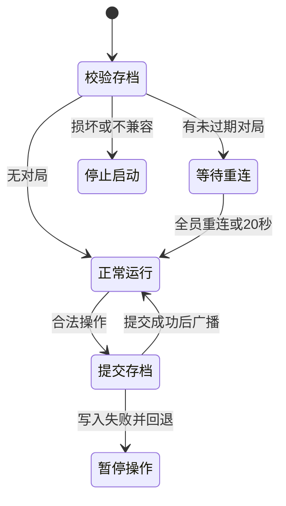

# 房间持久化与长局交互

日期：2026-10-28。软件迭代记录；实验6报告仍未填写。

## 房间存档

CLI启动默认使用`data/rooms.sqlite`。Node.js要求22.18或更新，本机使用22.23.2及内置`node:sqlite`，没有增加第三方数据库依赖。`GAME_ROOM_DB`可指向另一处私有位置；不能把数据库放到可发布的静态资源目录。数据目录、SQLite主文件和附属文件均不提交Git，Vite显式禁止读取默认数据目录和SQLite文件。

每次规则或大厅修改先写SQLite单条原子提交，再响应和广播。房间保存完整局面、身份哈希、最近128个已成功请求及其签名、私有随机密钥和计数器、剩余计时、AI请求占位与有限复盘。原始身份token只发给客户端，不在数据库或分享链接保存；数据库仍包含完整手牌和私有随机密钥，应作为私有服务数据管理。

SQLite使用WAL、FULL同步和生命周期排他锁，第二个服务不能同时使用同一数据库，避免两个独立内存房间覆盖状态。锁行为依据[SQLite官方WAL说明](https://www.sqlite.org/wal.html)与[locking_mode说明](https://www.sqlite.org/pragma.html#pragma_locking_mode)。该设计面向当前单服务课程原型，不支持多实例水平扩展。

## 恢复流程与异常

启动时逐层校验存档版本、地图、成员、角色、牌编号、完整引擎状态、奖励、实体、日志与计数，再预留引擎编号。恢复原房间号、gameId、手牌和骰值，不调用开局或重新投骰。校验复用本地存档规则，允许联机历史AI记录属于当前已经恢复真人控制的座位。

活动房间先等待原真人重连，全部回来可提前结束等待，最多20秒。停服与等待恢复期间不扣真人回合时间。原来已断线的成员仍可继续由AI接管；离席注销和房间清理已持久化，不会因重启复活。无活动30分钟或创建满2小时仍按真实时间过期，不能把重启当作延长房间寿命的方式。

AI分析发起前保存占位，重启中断时增加`SERVER_RESTART`接管记录，同回合不重复请求模型。旧模型进程的结果不能跨重启执行。每秒更新计时检查点；突然结束进程时剩余计时可能有约1秒检查点误差，已确认操作不依赖关闭回调保存。

运行中写入失败时回到最后成功提交的房间状态，取消AI分析，向所有房间显示保存失败并暂停操作。读取和查看原状态仍可进行；修复磁盘或权限问题后需重启。损坏或不兼容数据库保留原文件并拒绝启动，不自动删除或换成空房间。

## 长局手牌交互

手牌按可用宽度分页，并可按具体牌型筛选；同类牌保留各自UID和点数。投骰或结束牌固定显示，玩家不必翻完整副牌库才能交接回合。翻页和筛选不消耗牌，目标选择和规则执行仍走原命令入口。

牌区固定为一行，防止26张手牌挤掉整个棋盘。短横屏压缩牌面、行距和玩家信息，完整说明保留在ARIA标签及悬停提示中；阶段、倍速、适配和退出入口仍可见。等待其他玩家时，可浏览自己的库存，出牌权限仍由当前回合和服务端决定。

`tests/browser/hand.html`提供26张牌的独立合成UI场景，包含桌面、375竖屏、812横屏三个内嵌视口；不读取/写入玩家存档，不调用模型，不创建真实房间，不进入生产构建入口。页面显示实际视口、棋盘高度和页面宽度，便于继续回归。

## 验收证据

- `tests/roomPersistence.test.ts`覆盖SQLite关闭再打开、剩余计时、旧请求重放、随机序列连续、保存失败回退/暂停、过期清理、损坏文件保留、AI分析中断、单服务锁，以及真实子进程SIGKILL后的WAL恢复。进程强杀测试不等同于物理断电测试。
- 实际游戏房间856071在投骰3点、取得钩锁后重启统一服务，仍恢复第1回合相同手牌和骰值，刷新后可合法右移至(3,9)。测试后主动退出，该房间被清理。本地练习存档未被覆盖。
- 实际HTTP读取`/data/rooms.sqlite`、WAL文件和`/@fs/`对应路径均为403，`/api/health`仍为200；没有输出数据库内容。
- 26牌合成场景在标称375×812视口（实际帧374×811）中保留约548px棋盘，筛选瞬移后3页可查，实际拖牌并点击终点可完成结算。812横屏规格（实际811×374）压缩后棋盘由154px增至223px，牌区由220px减至151px，页面宽度等于视口。桌面可翻页，结束牌固定保留。

这些是本轮有限场景结果，不替代完整公网、设备兼容或长期负载验证。截图仅存本机`tmp/game-development`，不上传。
